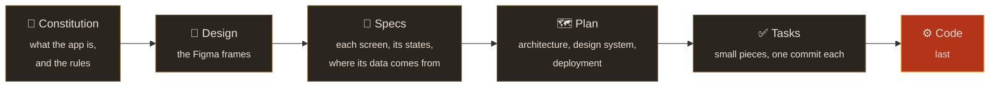

<p align="center">
  
</p>

<h1 align="center">Onkko's Archive</h1>

<p align="center">
  <em>"We watch, we anticipate, we intercede."</em><br>
  Been away from the Origin System for months? Onkko reads your public Warframe
  profile, tells you what shipped while you were gone, and shows you the road to
  the thing you want next.
</p>

<p align="center">
  <a href="https://onkkos-archive.vercel.app"><strong>Open the app</strong></a>
  ·
  <a href="https://onkkos-archive-storybook.vercel.app">Design system</a>
  ·
  <a href="specs/00-constitution.md">Constitution</a>
</p>

<p align="center">
  
  
  
  
</p>

## What it does

Two features, and the map they both lead to.

<table>
  <tr>
    <td width="50%" valign="top">
      
      <h3>Catch up</h3>
      Pick the update you last played. Onkko lists every warframe, weapon,
      companion and resource that shipped since then, and which of them you
      still lack.
    </td>
    <td width="50%" valign="top">
      
      <h3>Get the thing you want</h3>
      Search any item or quest. Onkko lays out what it takes, step by step:
      the quests first, then where each part drops, then what to build it from.
    </td>
  </tr>
</table>

<p align="center">
  
  <br>
  <em>Both end on the map: the place you are in, what is left to master there, and where to go next.</em>
</p>

## Privacy

A promise to every player who types an id here:

- **One public id, nothing else.** The app reads the same public profile the
  game shows when you look at another player. No login, no password, no email.
- **Kept for twelve hours, then gone.** Only the fields the app reads are kept,
  never the full profile and never a computed result.
- **On your device:** your id, the update you last played and the last place
  you opened, in cookies; the steps you ticked, in your browser. Disconnect
  forgets your id.
- **No analytics and no tracking.** There is nothing to opt out of.
- **DE's endpoint is protected.** A profile read once is kept and shared, one
  read at a time, two new lookups per visitor every twelve hours, and the app
  stops asking for thirty minutes when DE refuses.
  [`docs/api.md`](docs/api.md) has the detail.

## How it was built

Nothing here was written before it was decided. The work follows one order, and
every step answers to the one before it:



The [constitution](specs/00-constitution.md), [specs](specs/), [plan](specs/plan/)
and [tasks](specs/tasks/README.md#the-tasks) are all here, and each commit is
named after its task. [`docs/spec-driven-order.md`](docs/spec-driven-order.md)
explains the order.

### Where a screen comes from

What happens between typing an id and seeing a screen, and which part of the
code does each step:


The rules in `domain/` never touch the network, React or Next, so they can be
tested on their own. A lint rule fails any import that goes against the
arrows.

### The Cetus design system

<p align="center">
  
</p>

The look is Cetus, the Ostron town of the Plains of Eidolon, where scavenged
craft meets the Orokin's leftovers. Names are carved in Cinzel, prose is set
in Inter and the machine's readings in JetBrains Mono. Every colour is
measured for contrast and for colour blindness. [`docs/cetus.md`](docs/cetus.md)
explains the choices, and the [Storybook](https://onkkos-archive-storybook.vercel.app)
shows every token and component.

Claude assisted with research, implementation, debugging and documentation.

## Run it

```bash
pnpm install
cp .env.example .env.local
pnpm dev            # localhost:3000, on the two demo profiles
pnpm check          # types, lint, format and tests
pnpm storybook      # the design system at localhost:6006
```

| Variable                                             | What it does                                                                                            |
| ---------------------------------------------------- | ------------------------------------------------------------------------------------------------------- |
| `WF_PROFILE_SOURCE`                                  | `fixture` serves the two anonymised demo profiles and never reaches DE. Development always uses it      |
| `UPSTASH_REDIS_REST_URL`, `UPSTASH_REDIS_REST_TOKEN` | The shared store for the locks, in production only. Without them, an in-memory store serves development |

[`docs/development.md`](docs/development.md) covers the tooling, and
[`docs/content-updates.md`](docs/content-updates.md) how a new Warframe update
enters the app.

## Data and credits

Onkko's Archive stands on the work of others. Thank you.

| Source                                                                                                                                                                   | What the app takes from it                                                                                                                                                           | Terms                                                                                       |
| ------------------------------------------------------------------------------------------------------------------------------------------------------------------------ | ------------------------------------------------------------------------------------------------------------------------------------------------------------------------------------ | ------------------------------------------------------------------------------------------- |
| [Digital Extremes](https://www.warframe.com)                                                                                                                             | The player's public profile (`api.warframe.com`), the [patch notes](https://www.warframe.com/patch-notes), the [drop tables](https://www.warframe.com/droptables) and the game's art | Warframe and its content belong to Digital Extremes                                         |
| [WFCD · warframe-items](https://github.com/WFCD/warframe-items)                                                                                                          | Every item, its parts, its recipe and the update that brought it, from DE's Public Export                                                                                            | MIT                                                                                         |
| [WFCD · warframe-drop-data](https://github.com/WFCD/warframe-drop-data)                                                                                                  | DE's drop tables as data: rewards, rotations and chances                                                                                                                             | MIT                                                                                         |
| [WFCD · warframe-worldstate-data](https://github.com/WFCD/warframe-worldstate-data)                                                                                      | The star chart's nodes                                                                                                                                                               | MIT                                                                                         |
| [WFCD · warframestat.us](https://docs.warframestat.us)                                                                                                                   | The items' art (`cdn.warframestat.us`) and Varzia's stock                                                                                                                            | Free public API                                                                             |
| [The Warframe Wiki](https://wiki.warframe.com)                                                                                                                           | Missions, vendors, relics, resources and research from its data modules; the prose of a step; icons and update art, linked and never copied                                          | [CC BY-SA, page text CC BY-NC-SA 3.0](https://wiki.warframe.com/w/Warframe_Wiki:Copyrights) |
| [Cinzel](https://fonts.google.com/specimen/Cinzel), [Inter](https://fonts.google.com/specimen/Inter), [JetBrains Mono](https://fonts.google.com/specimen/JetBrains+Mono) | The three typefaces                                                                                                                                                                  | SIL Open Font License 1.1                                                                   |
| [Material Symbols Rounded](https://fonts.google.com/icons)                                                                                                               | The interface's own icons                                                                                                                                                            | Apache License 2.0                                                                          |

[`docs/curated-files.md`](docs/curated-files.md) lists every vendored file with
its source.

## Licence

The [MIT licence](LICENSE) covers the code and the curated files. Warframe and
its content belong to Digital Extremes. This is a fan project, not affiliated
with or endorsed by them.
