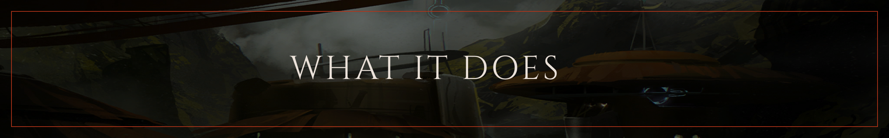
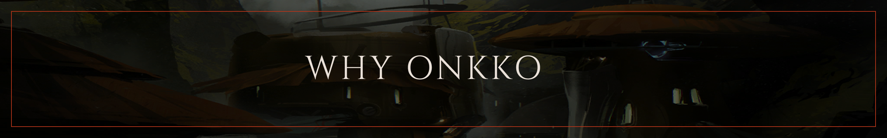
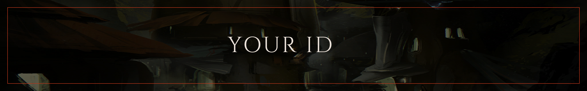
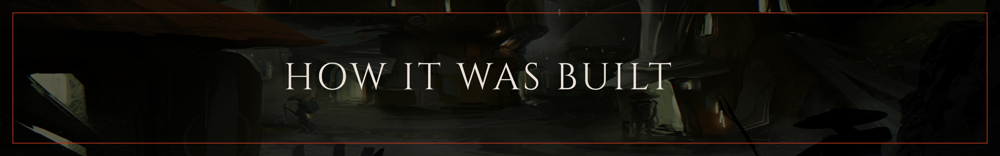
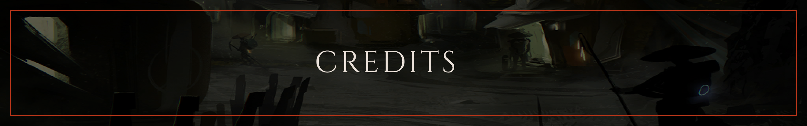

  

  <a href="https://github.com/a32-0/onkkos-archive/releases/latest"><strong>Download for Windows or Linux</strong></a>
  ·
  <a href="https://onkkos-archive.vercel.app">Try the demo</a>

Back in Warframe after a long break? Onkko's Archive reads your public
profile and tells you two things: what came out while you were away that you
don't have yet, and how to get the next thing you want, step by step.

The [demo](https://onkkos-archive.vercel.app) runs in your browser with two
sample players and needs nothing installed. To see your own account, download
the app:

- On Windows 10 or 11, run `onkkos-archive-{version}-setup.exe`. It installs
  for your user only and needs no admin rights. The installer isn't signed,
  so the first time Windows shows "Windows protected your PC". Click **More
  info**, then **Run anyway**.
- On Linux, make `onkkos-archive-{version}.AppImage` executable
  (`chmod +x`) and open it.

The app updates itself when you close it, and picks up new game data after
each Warframe update without a new version.

  

**To catch up,** tell it the last update you played. It lists everything released
since then, sorted by category, and marks the ones you're missing.

**To reach a goal,** pick something you want or search for it. You get its steps
in the order you'll do them: the quests that unlock it, where each part drops,
and what you build it from.

Both end on the star chart, one place at a time, showing how much of what's
there you have mastered and where to go next.

  

The wiki can tell you everything about one item, but it doesn't know what you
already have. An inventory tracker knows what you have, but it can't tell you
what you missed or what to do first. Onkko reads your profile and answers
those two questions, and nothing else.

That's why it only lists what you can master or collect: your arsenal
(warframes, weapons, companions, vehicles) and your collection (mods, arcanes,
relics, resources and the like). Skins, decorations and the rest of the game
aren't there, on purpose. The app also never reads your
screen or your game files, and it can't change anything in your account.

  

The app needs one thing from you: your account ID, a 24-character code. You
find it by logging in at [warframe.com](https://www.warframe.com), opening
your browser's developer tools (F12) and copying the value of the `gid`
cookie. It's public. The game shows the same profile to anyone who looks you
up, so there's no login, no password and no email.

The app reads your profile from your own computer, the way your game does.
There's no server of ours in between, and this is everything it keeps:

| What                                                                                                               | Where on your computer         | For how long                        |
| ------------------------------------------------------------------------------------------------------------------ | ------------------------------ | ----------------------------------- |
| The fields of your profile it uses, never the whole profile                                                        | The app's folder               | Twelve hours                        |
| Your ID, the update you last played, the last place you opened, whether Onkko speaks, whether you've seen the tour | The app's cookies              | Up to a year                        |
| The steps you tick                                                                                                 | The app's storage              | Until you clear them                |
| The wiki's text and icons, Varzia's stock, the rotations                                                           | Memory, while the app is open  | A day at most; Varzia's ten minutes |
| The game's data                                                                                                    | The app's folder               | Until a newer set replaces it       |
| A downloaded update                                                                                                | Your system's cache folder     | Until it installs                   |
| What went wrong, if anything: DE refusing a read, a failed update. Never your ID                                   | `app.log`, in the app's folder | Until it passes 1 MB                |

It never keeps anything it works out from your profile. Disconnect forgets
your ID. Uninstalling on Windows removes the app's folder; on Linux, delete
the AppImage and `~/.config/Onkko's Archive`.

What leaves your computer is only these reads: your profile from
`api.warframe.com`, text and art from `wiki.warframe.com`, `www.warframe.com`
and `www-static.warframe.com`, item art, Varzia's stock and the rotations from
`warframestat.us`, and the game data and app updates from GitHub. The app
sends no analytics. The demo reads no account at all; Vercel counts its page
views and how fast pages load, with no cookie and no ID.

DE's servers are looked after too. The app asks for one profile at a time,
each computer gets two new lookups every twelve hours, and if DE refuses, it
waits thirty minutes before asking again. [`docs/api.md`](docs/api.md) has the
details.

  

Every part of the app was decided in writing before any code. The work went
in six steps, and each one had to agree with the one before it:

1. The [constitution](docs/specs/00-constitution.md) is one page that says what the
   app is for, who it serves and what it must never do. When anything later
   disagrees with it, the constitution wins.
2. The design came next: every screen drawn in Figma, along with its other
   states, like an empty list, an error or a loading screen.
3. The [specs](docs/specs/) describe one screen each, written against those
   drawings. A spec says what the screen shows, where its data comes from,
   and how to check that it works.
4. The [plan](docs/history/plan/) decides how the code is organized, which design
   system the screens share, and how the app is built and released.
5. The [tasks](docs/history/tasks/README.md#the-tasks) cut the plan into small
   pieces. Each lists what must be true before it counts as done, and every
   commit is named after its task.
6. The code came last, one task at a time, with tests for what each task
   promises.

When code showed that a decision was wrong, the decision was changed first,
then the code. [`docs/history/spec-driven-order.md`](docs/history/spec-driven-order.md)
explains why the work runs in this order. **Claude assisted with research, implementation, debugging and documentation.**

  

This app wouldn't exist without other people's work. Thank you to all of them.

| Source                                                                                                                                                                   | What the app takes from it                                                                                                                                                           | Terms                                                                                                                                                                                                                                           |
| ------------------------------------------------------------------------------------------------------------------------------------------------------------------------ | ------------------------------------------------------------------------------------------------------------------------------------------------------------------------------------ | ----------------------------------------------------------------------------------------------------------------------------------------------------------------------------------------------------------------------------------------------- |
| [Digital Extremes](https://www.warframe.com)                                                                                                                             | The player's public profile (`api.warframe.com`), the [patch notes](https://www.warframe.com/patch-notes), the [drop tables](https://www.warframe.com/droptables) and the game's art | Warframe and its content belong to Digital Extremes                                                                                                                                                                                             |
| [WFCD · warframe-items](https://github.com/WFCD/warframe-items)                                                                                                          | Every item, its parts, its recipe and the update that brought it, from DE's Public Export                                                                                            | [MIT](https://github.com/WFCD/warframe-items/blob/master/LICENSE)                                                                                                                                                                               |
| [WFCD · warframe-drop-data](https://github.com/WFCD/warframe-drop-data)                                                                                                  | DE's drop tables as data: rewards, rotations and chances                                                                                                                             | [MIT](https://github.com/WFCD/warframe-drop-data/blob/main/LICENSE)                                                                                                                                                                             |
| [WFCD · warframe-worldstate-data](https://github.com/WFCD/warframe-worldstate-data)                                                                                      | The star chart's nodes                                                                                                                                                               | [MIT](https://github.com/WFCD/warframe-worldstate-data/blob/master/LICENSE)                                                                                                                                                                     |
| [WFCD · warframestat.us](https://docs.warframestat.us)                                                                                                                   | The items' art (`cdn.warframestat.us`) and Varzia's stock                                                                                                                            | The API: [MIT](https://github.com/WFCD/warframe-status/blob/main/LICENSE). The art is DE's                                                                                                                                                      |
| [The Warframe Wiki](https://wiki.warframe.com)                                                                                                                           | Missions, vendors, relics, resources and research from its data modules; the prose of a step; icons and update art, linked and never copied                                          | Text and modules: "Creative Commons Attribution–Share Alike License (CC BY-SA)"; the site's footer: "CC BY-NC-SA 3.0" ([copyrights](https://wiki.warframe.com/w/Warframe_Wiki:Copyrights))                                                      |
| [Cinzel](https://fonts.google.com/specimen/Cinzel), [Inter](https://fonts.google.com/specimen/Inter), [JetBrains Mono](https://fonts.google.com/specimen/JetBrains+Mono) | The three typefaces                                                                                                                                                                  | SIL Open Font License 1.1 ([Cinzel](https://github.com/NDISCOVER/Cinzel/blob/master/OFL.txt), [Inter](https://github.com/rsms/inter/blob/master/LICENSE.txt), [JetBrains Mono](https://github.com/JetBrains/JetBrainsMono/blob/master/OFL.txt)) |
| [Vercel Web Analytics and Speed Insights](https://vercel.com/docs/analytics)                                                                                             | How many people visit the demo, and how fast its pages load                                                                                                                          | [Vercel's terms](https://vercel.com/legal/terms)                                                                                                                                                                                                |
| [Material Symbols Rounded](https://fonts.google.com/icons)                                                                                                               | The interface's own icons                                                                                                                                                            | [Apache License 2.0](https://github.com/google/material-design-icons/blob/master/LICENSE)                                                                                                                                                       |

[`docs/curated-files.md`](docs/curated-files.md) lists every vendored file and
where it came from. To run the project or keep it going, see
[`docs/maintaining.md`](docs/maintaining.md).

The [MIT licence](LICENSE) covers the code and the curated files. Warframe and
its content belong to Digital Extremes. This is a fan project, not affiliated
with or endorsed by Digital Extremes.
