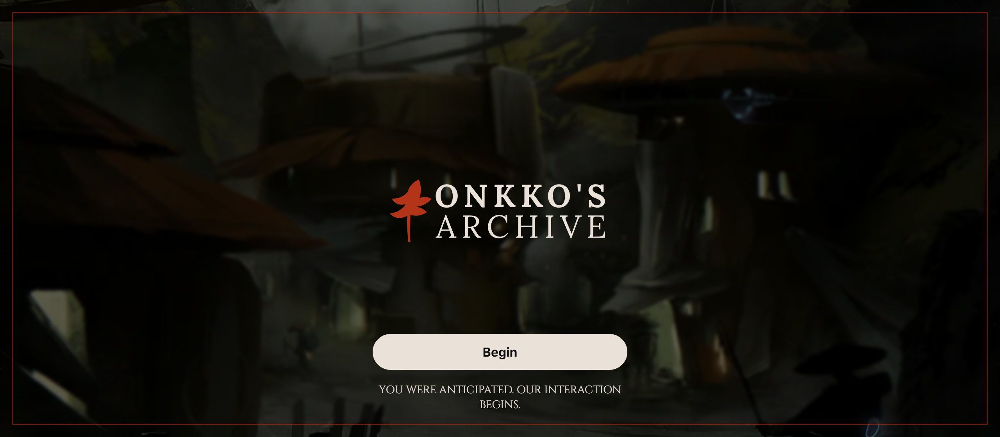
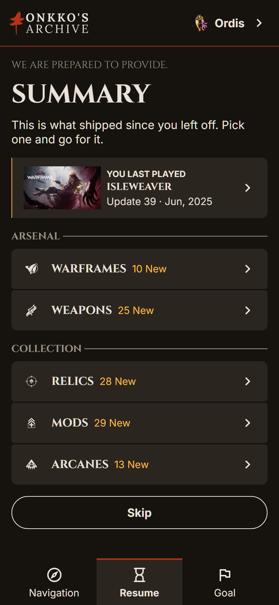
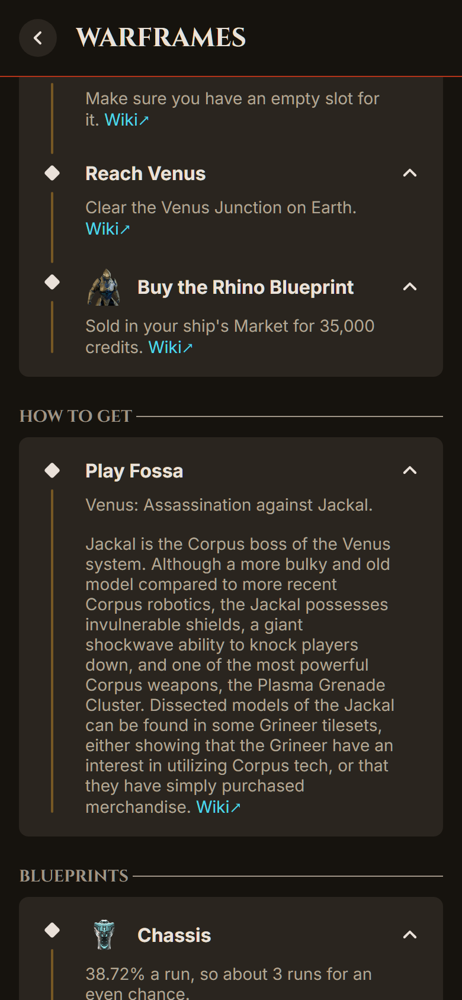
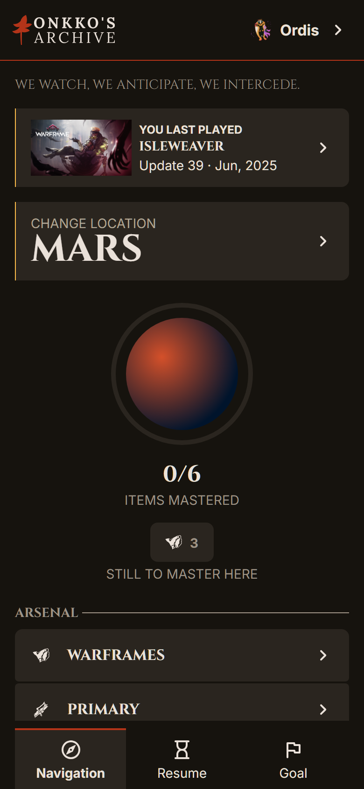
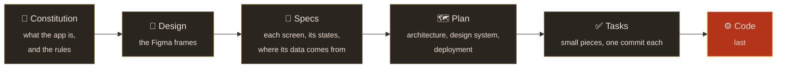
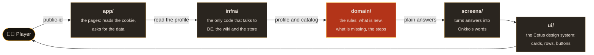
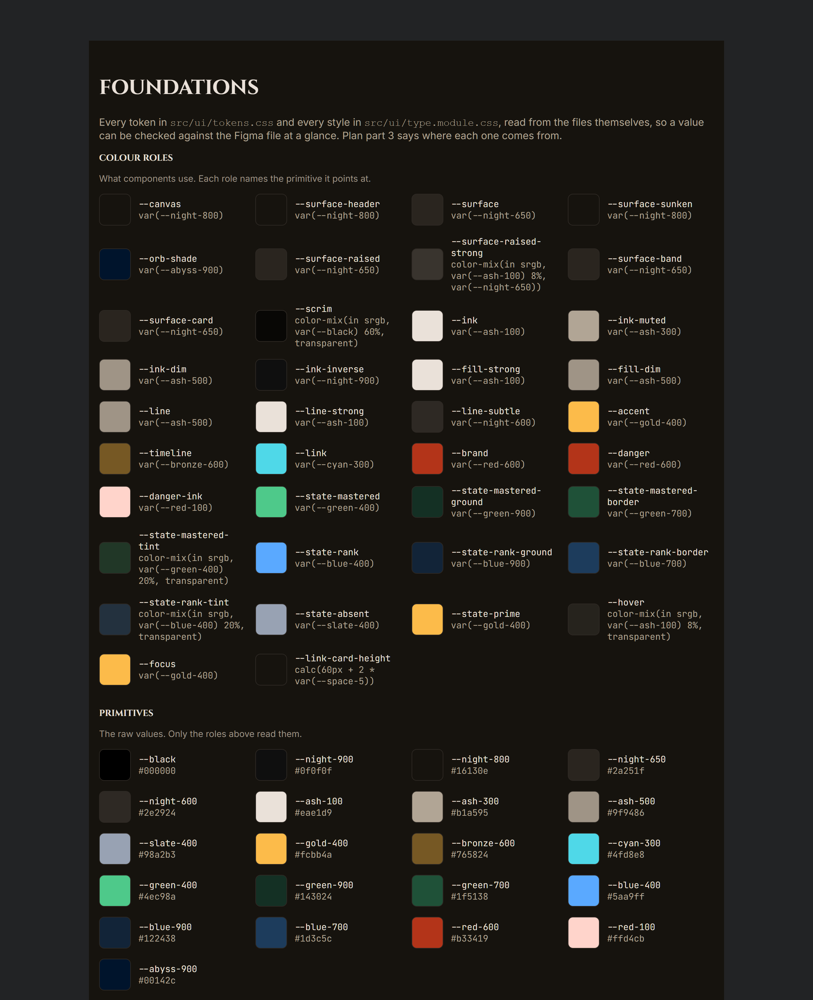

<p align="center">
  
</p>

<h1 align="center">Onkko's Archive</h1>

<p align="center">
  <em>"We watch, we anticipate, we intercede."</em><br>
  Been away from the Origin System for a while? Give Onkko your public Warframe
  profile and you'll see what shipped while you were gone, what you're still
  missing, and how to get the next thing you want.
</p>

<p align="center">
  <a href="https://onkkos-archive.vercel.app"><strong>Open the app</strong></a>
  ·
  <a href="https://onkkos-archive-storybook.vercel.app">Design system</a>
  ·
  <a href="specs/00-constitution.md">Constitution</a>
</p>

<p align="center">
  
  
  
  
</p>

## What it does

It does two things, and both end on the same map.

<table>
  <tr>
    <td width="50%" valign="top">
      
      <h3>Catch up</h3>
      Tell it the last update you played. You get every warframe, weapon,
      companion and resource that came out after it, and the ones you don't
      have yet are marked.
    </td>
    <td width="50%" valign="top">
      
      <h3>Get the thing you want</h3>
      Search for an item, a quest or a place. The page lists what it takes in
      the order you'll do it: the quests first, then where each part drops,
      then what you build it from. When a name isn't enough, the advanced
      search narrows the whole catalog by type, by what you own and by what
      you can reach.
    </td>
  </tr>
</table>

<p align="center">
  
  <br>
  <em>The map shows where you are, what you haven't mastered there yet, and where to go next.</em>
</p>

## Privacy

If you type your id here, this is what happens to it.

- The app only needs your public id. It reads the same profile the game shows
  anyone who looks you up. There's no login, no password and no email.
- It keeps the fields it reads for twelve hours and then drops them. It never
  stores your full profile or anything it worked out from it.
- Your id, the last update you played and the last place you opened live in
  cookies on your device. The steps you tick stay in your browser.
  Disconnect forgets your id.
- Vercel Web Analytics counts page views, and Speed Insights measures how fast
  pages load. Neither sets a cookie, and your id never appears in an address.
  Vercel counts a visitor as an anonymous hash and throws it away after a day.
  Nothing follows you to other sites, and there are no ads.
- DE's servers get looked after too. Once a profile is read, it's kept and
  shared. Reads happen one at a time, each visitor gets two new lookups every
  twelve hours, and if DE says no, the app waits thirty minutes before asking
  again. [`docs/api.md`](docs/api.md) has the details.

## How it was built

Nothing was coded before it was decided. Each step below had to agree with the
one before it:



You can read all of it: the [constitution](specs/00-constitution.md), the
[specs](specs/), the [plan](specs/plan/) and the
[tasks](specs/tasks/README.md#the-tasks). Every commit is named after its task,
and [`docs/spec-driven-order.md`](docs/spec-driven-order.md) explains why the
work runs in this order.

### Where a screen comes from

Here's what happens between typing an id and seeing a screen, and which part
of the code handles each step:



The rules in `domain/` never touch the network, React or Next, so you can test
them on their own. A lint rule fails any import that goes against the arrows.

### The Cetus design system

<p align="center">
  
</p>

The look comes from Cetus, the Ostron town on the Plains of Eidolon, built from
scavenged craft and Orokin leftovers. Names are set in Cinzel, running text in
Inter, and the machine's readings in JetBrains Mono. Every colour was checked
for contrast and for colour blindness. [`docs/cetus.md`](docs/cetus.md)
explains the choices, and the [Storybook](https://onkkos-archive-storybook.vercel.app)
shows every token and component.

Claude assisted with research, implementation, debugging and documentation.

## Run it

```bash
pnpm install
cp .env.example .env.local
pnpm dev            # localhost:3000, on the two demo profiles
pnpm check          # types, lint, format and tests
pnpm storybook      # the design system at localhost:6006
```

| Variable                                             | What it does                                                                                                 |
| ---------------------------------------------------- | ------------------------------------------------------------------------------------------------------------ |
| `WF_PROFILE_SOURCE`                                  | `fixture` serves the two anonymised demo profiles and never calls DE. Development always uses it             |
| `UPSTASH_REDIS_REST_URL`, `UPSTASH_REDIS_REST_TOKEN` | The shared store that holds the locks, in production only. Without them, development uses an in-memory store |

[`docs/development.md`](docs/development.md) covers the tooling.
[`docs/content-updates.md`](docs/content-updates.md) explains how a new
Warframe update gets into the app.

## Data and credits

This app wouldn't exist without other people's work. Thank you to all of them.

| Source                                                                                                                                                                   | What the app takes from it                                                                                                                                                           | Terms                                                                                                                                                                                                                                           |
| ------------------------------------------------------------------------------------------------------------------------------------------------------------------------ | ------------------------------------------------------------------------------------------------------------------------------------------------------------------------------------ | ----------------------------------------------------------------------------------------------------------------------------------------------------------------------------------------------------------------------------------------------- |
| [Digital Extremes](https://www.warframe.com)                                                                                                                             | The player's public profile (`api.warframe.com`), the [patch notes](https://www.warframe.com/patch-notes), the [drop tables](https://www.warframe.com/droptables) and the game's art | Warframe and its content belong to Digital Extremes                                                                                                                                                                                             |
| [WFCD · warframe-items](https://github.com/WFCD/warframe-items)                                                                                                          | Every item, its parts, its recipe and the update that brought it, from DE's Public Export                                                                                            | [MIT](https://github.com/WFCD/warframe-items/blob/master/LICENSE)                                                                                                                                                                               |
| [WFCD · warframe-drop-data](https://github.com/WFCD/warframe-drop-data)                                                                                                  | DE's drop tables as data: rewards, rotations and chances                                                                                                                             | [MIT](https://github.com/WFCD/warframe-drop-data/blob/main/LICENSE)                                                                                                                                                                             |
| [WFCD · warframe-worldstate-data](https://github.com/WFCD/warframe-worldstate-data)                                                                                      | The star chart's nodes                                                                                                                                                               | [MIT](https://github.com/WFCD/warframe-worldstate-data/blob/master/LICENSE)                                                                                                                                                                     |
| [WFCD · warframestat.us](https://docs.warframestat.us)                                                                                                                   | The items' art (`cdn.warframestat.us`) and Varzia's stock                                                                                                                            | The API: [MIT](https://github.com/WFCD/warframe-status/blob/main/LICENSE). The art is DE's                                                                                                                                                      |
| [The Warframe Wiki](https://wiki.warframe.com)                                                                                                                           | Missions, vendors, relics, resources and research from its data modules; the prose of a step; icons and update art, linked and never copied                                          | Text and modules: "Creative Commons Attribution–Share Alike License (CC BY-SA)"; the site's footer: "CC BY-NC-SA 3.0" ([copyrights](https://wiki.warframe.com/w/Warframe_Wiki:Copyrights))                                                      |
| [Cinzel](https://fonts.google.com/specimen/Cinzel), [Inter](https://fonts.google.com/specimen/Inter), [JetBrains Mono](https://fonts.google.com/specimen/JetBrains+Mono) | The three typefaces                                                                                                                                                                  | SIL Open Font License 1.1 ([Cinzel](https://github.com/NDISCOVER/Cinzel/blob/master/OFL.txt), [Inter](https://github.com/rsms/inter/blob/master/LICENSE.txt), [JetBrains Mono](https://github.com/JetBrains/JetBrainsMono/blob/master/OFL.txt)) |
| [Vercel Web Analytics and Speed Insights](https://vercel.com/docs/analytics)                                                                                             | How many people visit, and how fast the pages load                                                                                                                                   | [Vercel's terms](https://vercel.com/legal/terms)                                                                                                                                                                                                |
| [Material Symbols Rounded](https://fonts.google.com/icons)                                                                                                               | The interface's own icons                                                                                                                                                            | [Apache License 2.0](https://github.com/google/material-design-icons/blob/master/LICENSE)                                                                                                                                                       |

[`docs/curated-files.md`](docs/curated-files.md) lists every vendored file and
where it came from.

## Licence

The [MIT licence](LICENSE) covers the code and the curated files. Warframe and
its content belong to Digital Extremes. This is a fan project, and Digital
Extremes doesn't endorse it or have anything to do with it.
