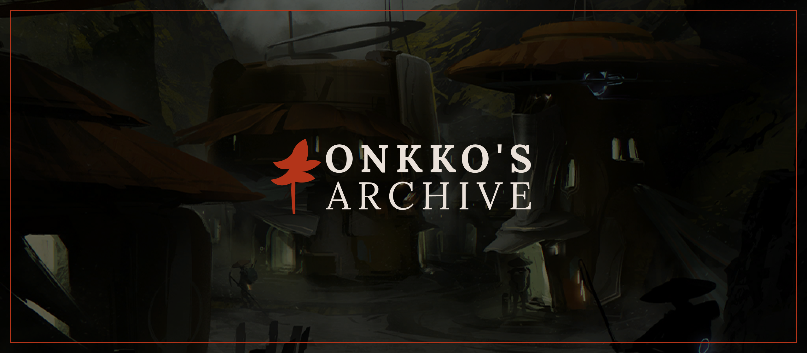
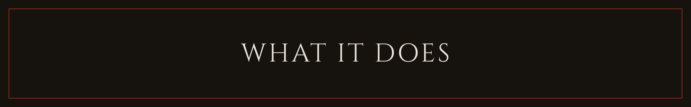
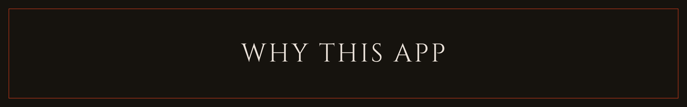
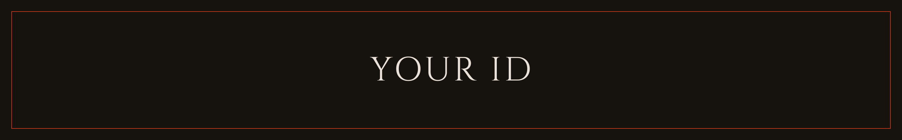
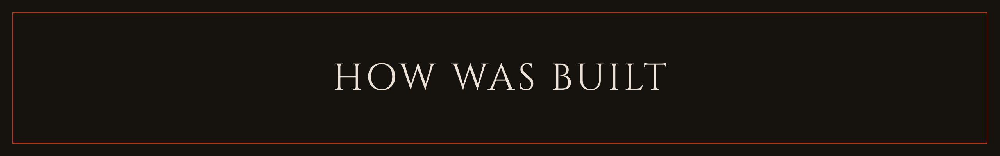
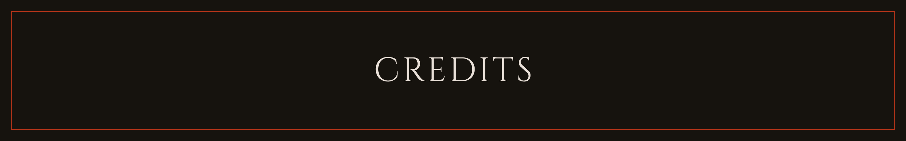

  

  <a href="https://github.com/a32-0/onkkos-archive/releases/latest"><strong>Download from GitHub</strong></a>
  ·
  <a href="https://onkkos-archive.vercel.app">Try the demo in your browser</a>

<h3>Back in Warframe after a long break? Onkko's Archive reads your public
profile and tells you two things: what came out while you were away that you
don't have yet, and how to get the next thing you want, step by step.</h3>

The [demo](https://onkkos-archive.vercel.app) runs in your browser with two
sample players and needs nothing installed. To see your own account, download
the app:

| Where                    | How                                                                                                                                                                                                                                               |
| ------------------------ | ------------------------------------------------------------------------------------------------------------------------------------------------------------------------------------------------------------------------------------------------- |
| **Windows 10 or 11**     | Get it from the [Microsoft Store](https://apps.microsoft.com/detail/9NVJBJD22L6D).                                                                                                                                                                |
| **Windows, from GitHub** | Download `onkkos-archive-{version}-setup.exe` and run it. It installs for your user only, with no admin rights. The installer isn't signed, so the first time Windows says "Windows protected your PC": click **More info**, then **Run anyway**. |
| **Linux**                | Download `onkkos-archive-{version}.AppImage`, make it executable (`chmod +x`) and open it.                                                                                                                                                        |

  

### ⏪ Catch up

Tell it the last update you played. It lists everything released since then,
sorted by category, and marks the ones you're missing.

### 🎯 Reach a goal

Pick something you want or search for it. You get its steps in the order
you'll do them: the quests that unlock it, where each part drops, and what you
build it from.

Both end on the **star chart**, one place at a time, showing how much of what's
there you have mastered and where to go next.

  

|                      | Knows what you have | Knows what you missed and what to do first |
| -------------------- | :-----------------: | :----------------------------------------: |
| The wiki             |          —          |                     —                      |
| An inventory tracker |         ✔️          |                     —                      |
| **Onkko's Archive**  |       **✔️**        |                   **✔️**                   |

Onkko reads your profile and answers those two questions, and nothing else.

- **What it lists:** only what you can master or collect. Your arsenal
  (warframes, weapons, companions, vehicles) and your collection (mods,
  arcanes, relics, resources and the like).
- **What it leaves out, on purpose:** skins, decorations and the rest of the
  game.
- **What it never does:** read your screen or your game files, or change
  anything in your account.

  

### The one thing it needs

Your **account ID**, a 24-character code:

1. Log in at [warframe.com](https://www.warframe.com).
2. Open your browser's developer tools (F12).
3. Copy the value of the `gid` cookie.

It's public. The game shows the same profile to anyone who looks you up, so
there's **no login, no password and no email**.

### Is it safe?

- **It stays on your computer.** There's no server of ours in between. The app
  keeps a trimmed copy of your profile, read again every 12 hours, and your ID
  in a cookie.
  **Disconnect**, in Profile, forgets it.
- **It only reads.** Your profile from `api.warframe.com`, text and art from
  the wiki and `warframestat.us`, game data and updates from GitHub. No
  analytics.
- **It's gentle with DE's servers.** Two new lookups per computer every 12
  hours, one at a time, and a 30-minute pause if DE refuses. Asking too often
  can lock an address out of the game itself, so the app never does.

The full list of what it keeps is in the
[privacy policy](docs/privacy.md), and how it protects DE's endpoint is in
[`docs/api.md`](docs/api.md).

  

### Built with Spec-Driven Development (SDD)

> **This isn't vibe coding.** Every part of the app was decided in writing
> before any code was written, and each step had to agree with the one
> before it.

| Step | What                                            | What it settles                                                                                                    |
| :--: | ----------------------------------------------- | ------------------------------------------------------------------------------------------------------------------ |
|  1   | [Constitution](docs/specs/00-constitution.md)   | One page: what the app is for, who it serves and what it must never do. When anything disagrees with it, it wins.  |
|  2   | Design                                          | Every screen drawn in Figma, with its other states: an empty list, an error, a loading screen.                     |
|  3   | [Specs](docs/specs/)                            | One per screen: what it shows, where its data comes from and how to check that it works.                           |
|  4   | [Plan](docs/history/plan/)                      | How the code is organized, which design system the screens share, how the app is built and released.               |
|  5   | [Tasks](docs/history/tasks/README.md#the-tasks) | The plan cut into small pieces, each with what must be true before it counts as done. Every commit names its task. |
|  6   | Code                                            | Written last, one task at a time, with tests for what each task promises.                                          |

**When the code showed a decision was wrong, the decision changed first, then
the code.** [`docs/history/spec-driven-order.md`](docs/history/spec-driven-order.md)
explains why the work runs in this order.

**Designed by a product designer, built with Claude.** I shaped the
experience, the design and the decisions; Claude wrote the code, the research
and the documentation alongside me.

  

This app wouldn't exist without other people's work. Thank you to all of them.

| Source                                                                                                                                                                                                                                                                                     | What the app takes from it                                                                                                                                                           | Terms                                                                                                                                                                                                                                                                                                                               |
| ------------------------------------------------------------------------------------------------------------------------------------------------------------------------------------------------------------------------------------------------------------------------------------------ | ------------------------------------------------------------------------------------------------------------------------------------------------------------------------------------ | ----------------------------------------------------------------------------------------------------------------------------------------------------------------------------------------------------------------------------------------------------------------------------------------------------------------------------------- |
| [Digital Extremes](https://www.warframe.com)                                                                                                                                                                                                                                               | The player's public profile (`api.warframe.com`), the [patch notes](https://www.warframe.com/patch-notes), the [drop tables](https://www.warframe.com/droptables) and the game's art | Warframe and its content belong to Digital Extremes                                                                                                                                                                                                                                                                                 |
| [WFCD](https://github.com/WFCD): [warframe-items](https://github.com/WFCD/warframe-items), [warframe-drop-data](https://github.com/WFCD/warframe-drop-data), [warframe-worldstate-data](https://github.com/WFCD/warframe-worldstate-data), [warframestat.us](https://docs.warframestat.us) | Every item with its parts, recipe and the update that brought it; the drop tables as data; the star chart's nodes; the items' art and Varzia's stock                                 | MIT ([items](https://github.com/WFCD/warframe-items/blob/master/LICENSE), [drop data](https://github.com/WFCD/warframe-drop-data/blob/main/LICENSE), [worldstate data](https://github.com/WFCD/warframe-worldstate-data/blob/master/LICENSE), [status](https://github.com/WFCD/warframe-status/blob/main/LICENSE)). The art is DE's |
| [The Warframe Wiki](https://wiki.warframe.com)                                                                                                                                                                                                                                             | Missions, vendors, relics, resources and research from its data modules; the prose of a step; icons and update art, linked and never copied                                          | Text and modules: "Creative Commons Attribution–Share Alike License (CC BY-SA)"; the site's footer: "CC BY-NC-SA 3.0" ([copyrights](https://wiki.warframe.com/w/Warframe_Wiki:Copyrights))                                                                                                                                          |

The [MIT licence](LICENSE) covers the code and the curated files. Warframe
and its content belong to Digital Extremes. This is a fan project, not
affiliated with or endorsed by Digital Extremes.
